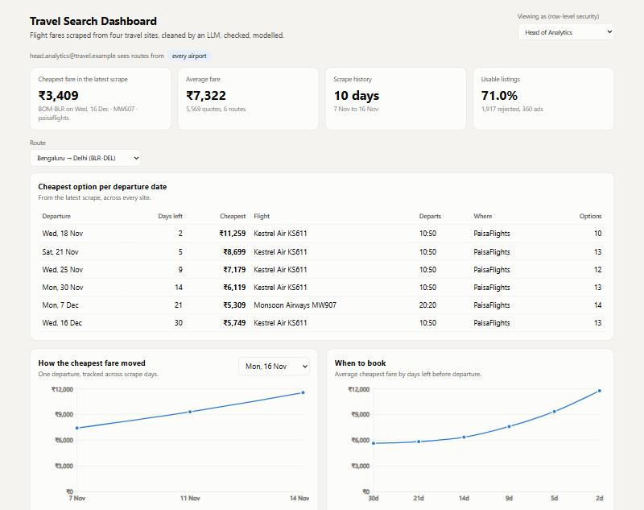

# Travel Search Dashboard

Scrape flight search results from several travel sites, let an LLM turn the messy
listings into clean rows, check every row, model the data as a star schema in
DuckDB, and publish it to **Power BI with row-level security**, so the Delhi desk sees
Delhi routes, the Mumbai desk sees Mumbai routes, and the head of analytics sees
everything.

It is the full stack a data analyst at a travel startup works across: a data layer
(scraping), a cleaning layer (LLM), a model (SQL), a dashboard (Power BI), and
governance (RLS). It runs completely offline out of the box, against four built-in
demo travel sites, with no API key.



## How it works

```mermaid
flowchart LR
    subgraph Sites["Travel sites"]
        S1[SkyBazaar]
        S2[PaisaFlights]
        S3[Kite Travel]
        S4[Ghoomo]
    end
    subgraph Data["1. Data layer: scrape"]
        F[Polite fetcher<br/>robots.txt, rate limit, retries] --> P[Parser<br/>CSS selectors from sites.json]
        P --> RAW[(raw lake<br/>JSONL per site per day)]
    end
    subgraph Clean["2. Cleaning layer: LLM"]
        C[Claude, structured outputs<br/>batches + cache] --> V[Deterministic checks]
        V --> OK[(clean rows)]
        V --> Q[(quarantine + reason)]
    end
    subgraph Model["3. Model: DuckDB"]
        STAR[(star schema<br/>fact_fare_quote + dims)] --> VIEWS[analysis views]
    end
    subgraph Serve["4. Dashboard"]
        PBI[Power BI report<br/>RLS role 'Desk'] 
        WEB[Web preview<br/>FastAPI + React, same RLS]
    end
    Sites --> F
    RAW --> C
    OK --> STAR
    Q --> STAR
    STAR -->|CSV + Parquet| PBI
    VIEWS --> WEB
```



1. **Data layer.** A fetcher that reads each site's `robots.txt`, waits between
   requests to the same host, and retries `429`/`5xx`. A parser that cuts each search
   page into result cards with three CSS selectors from
   [`sites.json`](server/app/config/sites.json). The raw text is saved untouched,
   partitioned by scrape date, so a better cleaner can re-run over old data later.
2. **Cleaning layer.** Every site writes the same facts differently: `₹4,599`,
   `Rs. 4599/-` and `₹ 4 599` are one price; `2h 15m`, `135 mins` and
   `2 ghante 15 min` are one duration. Claude reads batches of listings and returns
   validated JSON in one schema
   ([structured outputs](server/app/llm/anthropic_client.py)). Results are cached by
   content, so re-running never pays twice. Then plain Python
   [checks every row](server/app/clean/validate.py): does the route match the search,
   do the times fit the duration, is the price sane, is the carrier known? Anything
   that fails goes to a quarantine table with the reason, not into your numbers.
3. **Model.** A full rebuild of a DuckDB star schema (one fact table of fare quotes,
   dimensions for route, site, carrier, airport and date) plus SQL views for the
   questions the business asks. Exported as CSV and Parquet for Power BI.
4. **Dashboard.** A Power BI report you build from the export, with a dynamic RLS role
   driven by a `user_access` table, published to a workspace with the REST API. A small
   web preview (FastAPI + React) shows the same views with the same access rules, so
   you can see the result without Power BI.

## What the dashboard answers

| Question | Where |
| --- | --- |
| What is the cheapest way to fly this route on each date? | `v_cheapest_fares` |
| How did the fare for one departure move as the day got closer? | `v_price_trend` |
| How many days ahead should you book? | `v_lead_time_curve` |
| Which site is cheapest for the *same* flight, and by how much? | `v_site_spread`, site scorecard |
| How much of the scraped data is usable, and why not the rest? | `v_data_quality`, `quarantine` |

## Quickstart

You need **Python 3.11+** with [uv](https://docs.astral.sh/uv/), and **Node.js 20+**
for the web preview. Power BI Desktop (Windows) for the Power BI part.

### 1. Run the pipeline (offline, no key)

```bash
cd server
cp .env.example .env          # PowerShell: Copy-Item .env.example .env
uv sync
uv run python -m app.cli demo
```

This scrapes ten days of history from the four demo sites (about 7,800 listings),
cleans them, builds the warehouse and writes the Power BI export to
`server/data/powerbi/`. It takes under a minute.

```bash
uv run python -m app.cli eval
```

`eval` scores the cleaner field by field against the demo sites' ground truth. With
the default `LLM_PROVIDER=fake` (a regex cleaner) it gets about 76% of rows fully
right: perfect on the three sites it was written for, useless on Ghoomo, which writes
in Hinglish. That gap is the reason for the LLM layer.

### 2. Switch the cleaner to Claude

In `server/.env` set `LLM_PROVIDER=anthropic` and `ANTHROPIC_API_KEY=...`, then clean
into a fresh data folder and compare:

```bash
uv run python -m app.cli demo --days 1      # one day: about 780 listings
uv run python -m app.cli eval
```

Cost, estimated from token counts (not measured): one day is about 40 requests of 20
listings each, roughly 150k input and 120k output tokens. With the default
`claude-opus-5-5` at low effort that is around $3; `ANTHROPIC_MODEL=claude-haiku-5-5`
is under $0.10. Compare the two with `eval` before deciding. Already-cleaned listings
come from the cache and cost nothing.

### 3. Open the web preview

```bash
cd server
uv run uvicorn app.main:app --reload       # API on http://localhost:8000
```

In a second terminal:

```bash
cd client
cp .env.example .env
npm install
npm run dev                                 # http://localhost:5173
```

Use **Viewing as** at the top right to switch between the people in
[`user_access.json`](server/app/config/user_access.json) and watch the routes, totals
and charts change.

### 4. Build the Power BI report

Follow [**powerbi/README.md**](powerbi/README.md): load the export with the Power Query
script, add the relationships and DAX measures, create the `Desk` RLS role, test it
with *View as*, and publish (from Desktop, or with `uv run python -m app.cli publish`).

## Commands

Run from `server/`:

| Command | What it does |
| --- | --- |
| `uv run python -m app.cli demo [--days 10]` | scrape N days of demo sites, clean, build, export |
| `uv run python -m app.cli scrape [--as-of YYYY-MM-DD]` | one scrape of every enabled site |
| `uv run python -m app.cli clean` | clean new listings (cached ones are free) and run the checks |
| `uv run python -m app.cli build` | rebuild the DuckDB warehouse |
| `uv run python -m app.cli export` | CSV + Parquet for Power BI |
| `uv run python -m app.cli eval` | field-by-field accuracy of the cleaner (demo data) |
| `uv run python -m app.cli publish` | upload the `.pbix` to your Power BI workspace |
| `uv run pytest` | 38 tests, offline |

## Configuration

Everything editorial is JSON in [`server/app/config/`](server/app/config/), so adding a
site, a route or a person is an edit, not code:

| File | What it holds |
| --- | --- |
| `sites.json` | each site's search URL and the three CSS selectors |
| `search_plan.json` | routes, and how many days ahead to search on each scrape |
| `carriers.json` | airlines and every spelling of their names |
| `airports.json` | airports (for distances and city names) |
| `user_access.json` | who sees which origin airports (`"*"` = all) |

Settings live in `server/.env`, documented line by line in
[`server/.env.example`](server/.env.example).

## Project structure

```
travel-search-dashboard/
├── server/
│   ├── app/
│   │   ├── config/          # sites, routes, carriers, airports, user access (JSON)
│   │   ├── scrape/          # fetcher (robots, rate limit), parser, runner, demo sites
│   │   ├── llm/             # LLM interface, Claude client, offline fake, the prompt
│   │   ├── clean/           # schema, cleaning service + cache, checks, rules, eval
│   │   ├── warehouse/       # SQL: staging, star schema, views; build and export
│   │   ├── powerbi/         # publish a .pbix through the Power BI REST API
│   │   ├── api/             # FastAPI routes for the web preview, RLS dependency
│   │   ├── cli.py           # the pipeline commands
│   │   └── main.py          # FastAPI app
│   ├── scripts/make_samples.py
│   └── tests/
├── client/                  # React + TypeScript + Recharts web preview
├── powerbi/                 # Power Query, DAX measures, RLS role, theme, guide
├── samples/                 # one raw search page per demo site
└── docs/                    # architecture, interview notes, extending
```

## Scraping real sites

`SCRAPE_MODE=live` sends real HTTP requests to the sites in `sites.json`. Before you
point it at a real travel site, read that site's terms of service: many do not allow
automated access, and some protect search pages with bot detection that you must not
try to get around. Prefer an official API or an affiliate data feed where one exists.
The fetcher obeys `robots.txt` and rate-limits itself, but that does not make
scraping a site that forbids it acceptable. [docs/extending.md](docs/extending.md)
shows how to add a source.

## More

- [docs/architecture.md](docs/architecture.md): design decisions and the data model
- [docs/interview.md](docs/interview.md): how to put this on your CV and talk about it
- [docs/extending.md](docs/extending.md): add a site, hotels, Postgres, scheduled runs
- [powerbi/README.md](powerbi/README.md): the Power BI build, RLS and publishing

## License

MIT. The demo sites, airlines and fares are fictional.
