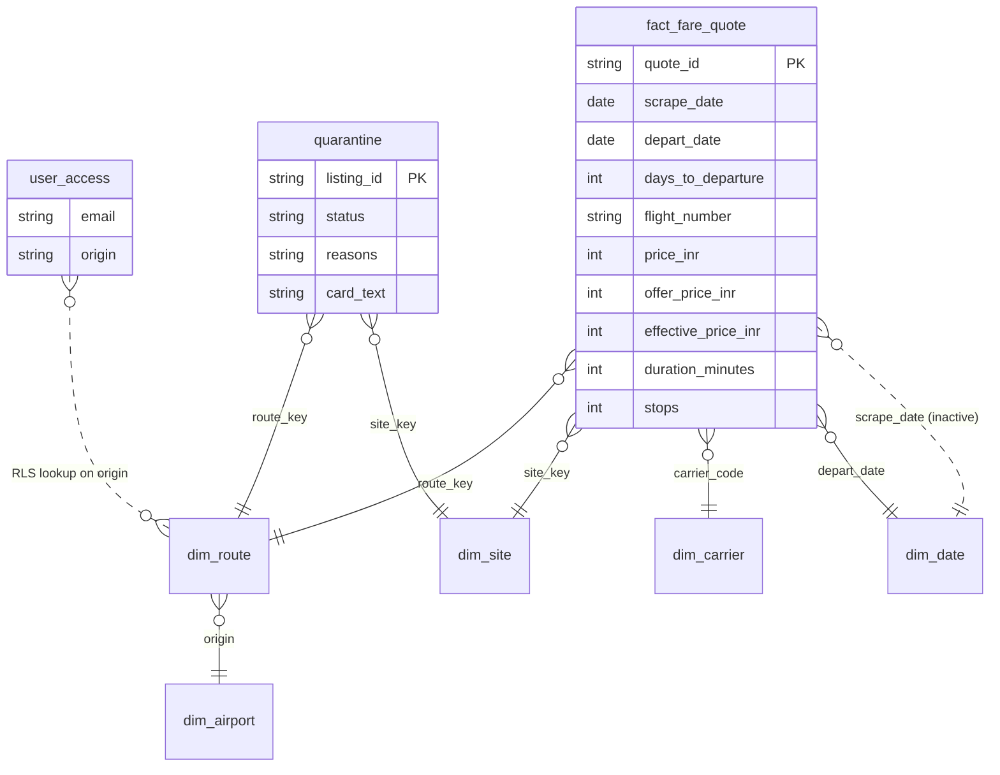

# Architecture

## Layers and the files behind them

| Layer | Input → output | Code |
| --- | --- | --- |
| Scrape | search plan → `data/raw/as_of=YYYY-MM-DD/<site>.jsonl` | `app/scrape/` |
| Clean | raw cards → `data/clean/as_of=.../<site>.jsonl` (+ `data/cache/clean_cache.jsonl`) | `app/clean/`, `app/llm/` |
| Model | raw + clean JSONL → `data/warehouse.duckdb` | `app/warehouse/sql/*.sql`, `build.py` |
| Export | warehouse → `data/powerbi/*.csv`, `*.parquet`, `views/*.csv` | `app/warehouse/export.py` |
| Serve | warehouse → JSON for the web preview | `app/api/` |
| Publish | `.pbix` → Power BI workspace | `app/powerbi/publish.py` |

Each layer reads only the previous layer's files, so you can re-run any one of them on
its own: re-clean with a new model without scraping again, or rebuild the warehouse
after changing a view without cleaning again.

## Decisions, and why

**Keep the raw text.** The scraper stores what it saw, not what it understood. Prices
and times are only parsed in the cleaning layer, so when the cleaner improves, every
past scrape can be cleaned again. Real pipelines lose history by parsing on the way in.

**The LLM cleans, Python checks.** Claude is good at reading "Ravana 06h15 → Pahunch
08h30" as departure 06:15, arrival 08:30. It is not a source of truth. Every record it
returns goes through deterministic checks (route matches the search, times fit the
duration, price in range, known carrier, offer below price) and a failure is
quarantined with a reason instead of reaching the dashboard. The data-quality page
makes those numbers visible, which is what keeps people trusting the rest of it.

**Structured outputs, not prompt-and-parse.** The cleaner asks for a Pydantic schema
(`CleanBatch`) and gets validated JSON back. No regexes over model prose, no "the
model added a sentence before the JSON" bugs.

**Batches and a content cache.** Twenty listings per request keeps the system prompt
cost per listing low. The cache key is a hash of (site, search, page header, card
text), so the same listing seen twice is cleaned once, and a re-run after a crash only
pays for what is missing.

**Ground truth for evaluation.** The demo sites are generated, so they know the right
answer for every card. `eval` turns "the LLM seems good" into a per-field accuracy
table, and lets you compare models and prompts with numbers instead of impressions.

**A full rebuild, not incremental loads.** DuckDB rebuilds months of data in about a
second. A rebuild cannot drift; an incremental load can. It is written to a temporary
file and swapped in, so the API never reads half a warehouse.

**A star schema for Power BI.** One fact table (`fact_fare_quote`, a row per price
seen) and small dimensions. Power BI's engine is built for this shape: filters flow
from dimensions to the fact, measures stay simple, and RLS on one dimension
(`dim_route`) secures every fact row through the relationship.

**RLS from a table, not hard-coded roles.** One role (`Desk`) filters `dim_route` to
the origins listed against `USERPRINCIPALNAME()` in `user_access`. Adding a person or
changing their airports is a JSON edit and a refresh, not a new role. `"*"` is
expanded to one row per airport at build time so the DAX never needs a special case,
and an unknown email matches nothing, so the failure mode is "sees nothing", not
"sees everything".

**The web preview enforces the same rule.** `app/api/deps.py` resolves the caller's
airports from the same JSON, and every query filters with
`list_contains(?, origin)` *before* aggregating, so a total can never include a
hidden route. A route outside your airports returns 404, not 403, so the API does not
confirm it exists. The `X-User-Email` header is a stand-in for real sign-in; behind
SSO, take the email from the verified token.

## Data model

`effective_price_inr` is the offer price when the listing states a cashback or coupon,
else the listed price. It is what the traveller pays, so every "cheapest" uses it.

## Where the demo data comes from

`app/scrape/demo_sites.py` generates four fictional sites on `.example` hosts (a
reserved name that cannot reach a real server) and serves them through an `httpx`
mock transport. The scraper's real code path runs against them: robots.txt (one site
sets `Crawl-delay: 3`), rate limiting, HTTP, HTML parsing. Fares come from a seeded
model: distance, days to departure (close-in fares climb steeply), Friday and Sunday
peaks, carrier, stops, a per-site factor, and noise shared across sites so the same
flight moves together everywhere. Ghoomo writes in Hinglish and the regex cleaner was
never taught it; SkyBazaar shows a few "Fare unavailable" cards that the checks must
reject.
